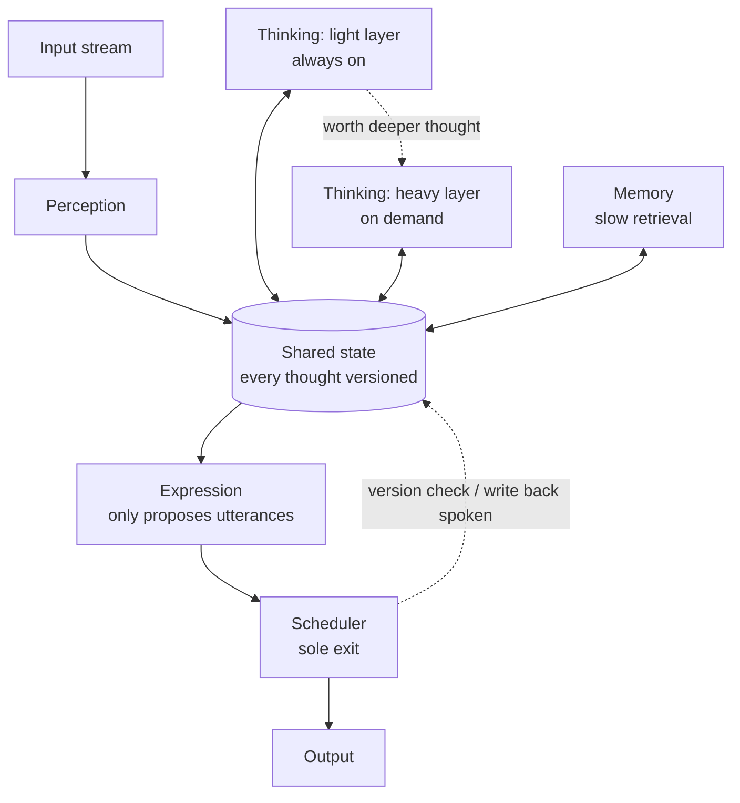

# Undertone

**English** | [简体中文](README.zh-CN.md)

> Think while you type. A parallel-thinking architecture for real-time text dialogue.

**Status: concept stage (draft).** This repository currently holds the research concept and experiment design. There is no runnable implementation yet. Critiques, related-work pointers and prototype contributions are welcome.

---

## Contents

- [Motivation](#motivation)
- [Core idea](#core-idea)
- [Architecture](#architecture)
- [Design principles](#design-principles)
- [Continuous thinking and cost](#continuous-thinking-and-cost)
- [Hypotheses](#hypotheses)
- [Related work](#related-work)
- [Evaluation plan](#evaluation-plan)
- [Challenges and risks](#challenges-and-risks)
- [What this is not](#what-this-is-not)
- [Roadmap](#roadmap)
- [Contributing](#contributing)

---

## Motivation

Today's LLM dialogue is **turn-based**: the user finishes, the model reads, answers in one go, then stops. While answering, it cannot perceive the user, and thinking and speaking are the same act: whatever it thinks, it says.

Human conversation is different:

- We keep watching the other person's reactions while we talk.
- We are already thinking while we listen.
- Much of what we think is never said aloud.
- When interrupted, we don't wipe our train of thought; we treat the interruption as new information.

The core difference: **human thinking is independent of conversational turns and never stops running.**

Three concrete gaps this project targets:

1. **Idle during input**: while the user is still typing, the model does nothing.
2. **Thinking tied to speaking**: everything thought is said; there is no "thought but unspoken".
3. **No on-the-spot correction**: once an answer starts it can only run to the end, and an interruption can't be folded into the existing line of thought.

## Core idea

Separate "thinking" from "speaking", and let a **continuously running thought process** span the whole conversation. The system is made of modules with different speeds and responsibilities. Modules never call each other directly; they only read and write a **versioned shared state**, and only one **scheduler** module holds the right to speak.

What this should feel like:

- You pause mid-sentence and it says "mm...", showing it's listening without grabbing the floor.
- Before you finish, it is already working out what you mean.
- Midway through an answer it remembers something new and adds it, or says "correction".
- You interrupt; it stops at once and folds your words into its own line of thought instead of starting over.

The concept doesn't depend on speech. In text, the rhythm of your typing, your pauses, edits and the Enter key are its "hearing".

## Architecture

### Shared state

Holds input events, current understanding, thoughts (tentative or confirmed), pending points to say, and what has already been said. Every record carries a version number and timestamp.

### Module responsibilities

| Module | Responsibility | Phase |
|---|---|---|
| **Perception** | Reads the input stream and emits events (still typing, pause, send, interrupt) into the shared state | 1 |
| **Thinking: light layer** | Always on. Continuously absorbs events and maintains the "current understanding" and "things I'm about to say", including reflection and anticipation while nobody is speaking | 1 |
| **Thinking: heavy layer** | On demand. Escalated to a stronger model when the light layer judges something worth deeper thought; results are written back | 1 |
| **Expression** | Reads the state and proposes what to say; cannot output by itself | 1 |
| **Scheduler** | Sole holder of output rights. Chooses among listening, thinking, backchanneling, speaking and correcting; checks versions before releasing and writes back what was said | 1 (rule-based) |
| **Memory** | Slow retrieval, results written back to the state | 2 |
| **Self-monitoring** | Compares what was said with the latest thoughts and triggers corrections | 2 |

## Design principles

1. **Shared state, versioned.** No direct calls between modules. Before each sentence, Expression checks whether the thought version it relies on is stale; if so it drops the sentence or triggers a correction.
2. **Thoughts are revised incrementally, not rewritten.** New input updates existing thoughts; only a large enough revision may overturn them.
3. **Only the scheduler holds the floor.** Other modules can only make requests, never output directly, so modules don't talk over each other.
4. **Thinking is continuous but layered.** See below.
5. **Speculative thoughts are marked tentative.** Thoughts formed on unfinished input may be overturned by what follows; only confirmed thoughts may enter Expression.

## Continuous thinking and cost

People think even when it's quiet, so thinking must be **continuous**, not triggered only when an input event arrives. Otherwise the system is just a more eager turn-based loop.

But continuous does not mean full power. The brain runs on a tight energy budget through layering: mostly cheap background processing, with only a small share escalated to effortful conscious reasoning. This project uses the same structure:

- **Always-on light layer**: a small model or incremental update that keeps maintaining understanding and what's about to be said. It outputs state deltas, not full rewrites.
- **On-demand heavy layer**: a larger model starts only when the light layer judges it worthwhile.
- **Engineering**: reuse the KV cache for incremental prefill instead of rereading the whole context each time.

So cost is not a constraint to dodge but a research question: **how light can the always-on thinking be while still producing a sense of presence?**

## Hypotheses

| ID | Hypothesis | Notes |
|---|---|---|
| **H1** | Thinking during input | Incremental understanding and pre-thinking while the user types shortens response latency and improves relevance. Text-side "hearing" signals (pauses, edits, Enter) are little studied |
| **H2** | Continuous update and continuation | Updating existing thoughts on new input or interruption, rather than regenerating, improves coherence after interruption |
| **H3** | On-the-spot correction | If a thought update makes already-spoken content stale, correcting it ("correction: ...") beats staying silent or finishing blindly |
| **H4** | Continuity itself has value | Always-on thinking that doesn't depend on input events improves naturalness over purely event-driven thinking |

## Related work

Almost every individual component has precedent. **This project does not claim to invent the blackboard architecture or turn-taking mechanisms**; it inherits them.

| Tradition | Representative work | Relation to this project |
|---|---|---|
| **Cognitive architectures / blackboard systems** | Hearsay-II, SOAR, ACT-R, global workspace theory; recent LLM multi-agent blackboards | The architectural skeleton belongs to this tradition |
| **Incremental dialogue and turn-taking** | Schlangen / Skantze incremental processing, VAP and other turn-taking models, backchannel generation | The scheduler addresses the same problem; borrow their methods and evaluations |
| **Inner thoughts / dual systems** | Proactive Conversational Agents with Inner Thoughts, Talker-Reasoner, sleep-time compute, MemGPT-style memory | Covers "think but don't say", front/back separation and idle-time computation; the closest overlap |
| **Full-duplex and listen-while-thinking (speech)** | Moshi, Chronological Thinking, FLAIR, LTS-VoiceAgent, SALMONN-duo | Mostly speech, and mostly single-model internals or a fixed two-role split |

> **Note**: this table is based on abstracts and recollection, **not yet on close reading of each paper. Exact boundaries need verification.** Please point out omissions or errors via Issues.

### Where this project differs

- Focus on **real-time parallel dialogue in text**
- Treat **thinking during input**, **thought continuation** and **on-the-spot correction** as separately testable hypotheses
- Answer the cost question with **layered continuous thinking**, and test via ablation whether continuity is actually necessary

## Evaluation plan

### Baseline comparison

Same base model, **turn-based** vs **parallel architecture**.

### Ablations

Remove each of the following in turn to measure its contribution:

- Thinking during input (H1)
- Thought continuation (H2)
- Version checks and correction (H3)
- Always-on thinking, replaced by purely event-driven thinking (H4)
- The "think but don't say" inner activity

> If removing a component doesn't reduce naturalness, that component is over-engineering and should be dropped.

### Metrics

| Metric | Meaning |
|---|---|
| Response latency | Time from the user sending to the first output token |
| Post-interruption coherence | Whether the answer continues the earlier line of thought after an interruption (human + model judges) |
| Correction quality | Whether corrections are needed and accurate, and whether there are over-corrections |
| Subjective naturalness | Pairwise preference ratings |
| Extra cost | Added tokens and latency relative to turn-based |

### Initial task scenarios

1. Q&A where the user keeps adding information while typing
2. Multi-turn conversations where the user changes their mind midway
3. Long answers interrupted by follow-up questions

## Challenges and risks

| Challenge | Mitigation |
|---|---|
| The scheduler is essentially a hard-to-learn turn-taking policy: rules are rigid, a model reverts to a single model | Rules as a fallback in phase 1; learned scoring in phase 2; evaluate the scheduler's contribution separately |
| Continuous thinking is costly | Layering (light always-on, heavy on demand); track extra cost as a core metric |
| Concurrency consistency of shared state | Version numbers plus pre-expression checks; stale content dropped or corrected |
| Thoughts on unfinished input may be overturned | Mark as tentative; only confirmed thoughts may be expressed |
| Naturalness is hard to measure objectively | Pairwise preference evaluation combined with behavioral metrics (latency, coherence) |

## What this is not

- **Not about being smarter.** It doesn't aim to raise answer accuracy, but to feel like talking with someone who is *present*.
- **Not a brain replica.** The module split is just an analogy for organizing responsibilities.
- **Not a new invention of architecture.** Blackboards and turn-taking are inherited from prior work.
- **Not dependent on speech.** Phase 1 is text only.

## Roadmap

- [ ] **Literature verification**: read related work closely and revise the boundaries
- [ ] **Phase 1 prototype**: perception, thinking (light/heavy), expression, rule-based scheduler
- [ ] **Baseline experiments**: turn-based vs parallel across the three scenarios
- [ ] **Ablation and cost analysis**: test H1–H4 and decide which components stay
- [ ] **Phase 2**: memory and self-monitoring
- [ ] **Extension**: evaluate extending to speech

## Contributing

What helps most right now:

- **Related work**: omissions, errors, or closer prior art
- **Evaluation design**: more reliable ways to measure "presence"
- **Prototype implementation**: concrete approaches to the always-on light layer

Please open an Issue or Pull Request.

## License

TBD.
