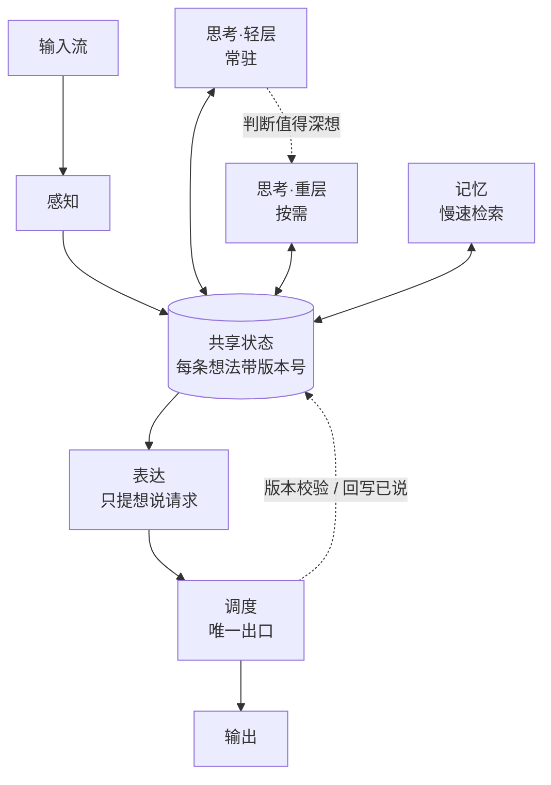

# Undertone · 并行心智

[English](README.md) | **简体中文**

> 让 AI 在你输入的同时就开始思考，把"想"和"说"拆开，并且能在说错时当场更正。

**状态：设想阶段（Draft）。** 本仓库目前是研究设想与实验设计，尚无可运行实现。欢迎批评、补充相关工作和参与原型。

---

## 目录

- [动机](#动机)
- [核心思路](#核心思路)
- [架构](#架构)
- [设计原则](#设计原则)
- [持续思考与成本](#持续思考与成本)
- [研究假设](#研究假设)
- [相关工作](#相关工作)
- [验证方案](#验证方案)
- [难点与风险](#难点与风险)
- [不是什么](#不是什么)
- [路线图](#路线图)
- [参与](#参与)

---

## 动机

当前大模型对话是**回合制**的：用户说完，模型读完，一次性回答，然后停下。回答时它感知不到用户，想和说是同一件事，想到什么就说什么。

人的对话不是这样：

- 说话时还在观察对方的反应
- 听的时候已经在想
- 想到的很多东西不会说出口
- 被打断时不会清空思路，而是把打断当作新信息

核心差别是：**人的思考独立于对话回合，一直在运转。**

本项目关心的具体差距有三个：

1. **输入期空转**：用户还在输入时，模型什么都不做。
2. **想与说绑定**：想到的都会说出来，没有"想了但不说"。
3. **无法当场更正**：回答一旦开始只能说完，被打断后也不能把新信息接进已有思路。

## 核心思路

把"想"从"说"里分出来，让一个**持续运行的思考过程**贯穿整个对话。系统由速度不同、职责不同的模块组成，模块之间不互相调用，只读写一块**带版本的共享状态**，输出权只归一个**调度**模块。

带来的对话感：

- 你说到一半停下，它会"嗯…"，表示在听，但不抢话。
- 你还没说完，它已经在理解你的意思。
- 它说到一半想起了新东西，会接着补充，或说"更正一下"。
- 你打断它，它立刻停下，把你的话接进自己的思路，而不是从头再来。

本设想不依赖语音。在文本场景中，输入的节奏、停顿、删改和回车就是它的"听觉"。

## 架构

### 共享状态

保存：输入事件、当前理解、想法（暂定或确认）、待说要点、已说内容。每条记录带版本号和时间戳。

### 模块职责

| 模块 | 职责 | 阶段 |
|---|---|---|
| **感知** | 读取输入流，产出事件：继续输入、停顿、发送、打断，写入共享状态 | 一期 |
| **思考·轻层** | 常驻运行。持续吸收事件，维护"当前理解"和"待说苗头"，包括无人说话时的回味与预想 | 一期 |
| **思考·重层** | 按需运行。轻层判断值得深想时升级到更强的模型，结果回写状态 | 一期 |
| **表达** | 只读状态，生成"想说什么"的请求，自己不能输出 | 一期 |
| **调度** | 唯一有输出权。在听、想、附和、说、更正之间选择；放行前校验版本，说完后回写"已说内容" | 一期（规则） |
| **记忆** | 慢速检索，结果回写状态 | 二期 |
| **自我监控** | 比对已说内容与最新想法，触发更正 | 二期 |

## 设计原则

1. **共享状态，带版本。** 模块之间不直接调用。表达模块在说每一句话之前，检查所依据的想法版本是否已过期；过期则丢弃，或触发更正。
2. **想法增量修订，不整体重写。** 新输入来了，更新已有想法，只有修订幅度过大时才允许推翻。
3. **话语权只归调度。** 其他模块只能提出请求，不能直接输出，避免各说各的。
4. **思考持续，但分层。** 见下节。
5. **推测性想法标为"暂定"。** 用户输入未完成时的想法可能被后续输入推翻，只有确认后才允许进入表达。

## 持续思考与成本

人在安静时也在想，所以思考必须是**持续的**，而不是只在输入事件到来时才触发。否则系统只是"更勤快的回合制"。

但持续不等于满功率。大脑功耗有限，靠的是分层：大部分是廉价的常驻背景处理，只有少数内容升级为费力的有意识推理。本项目采用同样的结构：

- **常驻轻层**：小模型或增量更新，持续维护理解和想说的苗头。输出的是状态差量，而不是完整重写。
- **按需重层**：轻层判断值得深想时才启动大模型。
- **工程手段**：复用 KV cache 做增量预填充，避免每次重读全文。

因此成本不是需要回避的约束，而是一个研究问题：**多轻的常驻思考，就足以产生"在场感"？**

## 研究假设

| 编号 | 假设 | 说明 |
|---|---|---|
| **H1** | 输入期思考 | 在用户输入过程中增量理解、预先思考，可显著缩短响应延迟并提升回答贴合度。文本场景下的"听觉"信号（停顿、删改、回车）研究很少 |
| **H2** | 想法持续更新与接续 | 新输入或打断到来时更新已有想法，而非重新生成，可提升打断后的连贯性 |
| **H3** | 当场更正 | 表达过程中若思考更新使已说内容过期，以"更正一下"修补，优于沉默或硬说完 |
| **H4** | 持续性本身有价值 | 常驻的、不依赖输入事件的思考，比纯事件驱动的思考更能提升自然感 |

## 相关工作

单个部件几乎都有先例，**本项目不主张发明黑板架构或轮流发言机制**，这些直接继承既有工作。

| 传统 | 代表工作 | 与本项目的关系 |
|---|---|---|
| **认知架构 / 黑板系统** | Hearsay-II、SOAR、ACT-R、全局工作空间理论；近年的 LLM 多智能体黑板 | 架构骨架属于这一传统 |
| **增量对话与轮流发言** | Schlangen / Skantze 的增量处理框架、VAP 等 turn-taking 模型、附和（backchannel）生成 | 调度要解决的就是这个问题，应借用其方法与评测 |
| **内心想法 / 双系统** | Proactive Conversational Agents with Inner Thoughts、Talker-Reasoner、sleep-time compute、MemGPT 类记忆 | 覆盖"想而不说""前后台分离""空闲时持续计算"，与本项目重叠最多 |
| **全双工与边听边想（语音）** | Moshi、Chronological Thinking、FLAIR、LTS-VoiceAgent、SALMONN-duo | 集中在语音，多为单模型内部机制或固定两角色 |

> **注意**：上表基于对论文摘要与记忆的梳理，**尚未逐篇精读，具体边界需核实**。欢迎通过 Issue 指出遗漏或错误。

### 本项目的差异点

- 聚焦**文本场景**的实时并行对话
- 把**输入期思考**、**想法接续**、**当场更正**作为可单独检验的假设
- 用**分层的持续思考**回答成本问题，并以消融实验检验"持续性"是否必要

## 验证方案

### 对照

同一底座模型，比较**回合制**与**并行架构**。

### 消融

逐个去掉以下部件，判断各自贡献：

- 输入期思考（H1）
- 想法接续（H2）
- 版本校验与更正（H3）
- 常驻持续思考，改为纯事件驱动（H4）
- "想而不说"的内心活动

> 如果去掉某部分后自然感不下降，该部分即为过度设计，应当删除。

### 指标

| 指标 | 含义 |
|---|---|
| 响应延迟 | 用户发送到首字输出的时间 |
| 打断后连贯性 | 被打断后回答是否衔接已有思路（人工 + 模型评审） |
| 更正质量 | 更正是否必要、准确，有无过度更正 |
| 主观自然度 | 成对比较的偏好评分 |
| 额外成本 | 相对回合制的额外 token 与延迟开销 |

### 初始任务场景

1. 边打边补充信息的问答
2. 多轮中途改口
3. 长回答中途被追问

## 难点与风险

| 难点 | 对策 |
|---|---|
| 调度本质上是难学的轮流发言策略；规则僵硬，模型又回到单模型 | 一期用规则兜底；二期引入学习型打分；评测时单独拆出调度的贡献 |
| 持续思考成本高 | 分层（轻层常驻、重层按需）；记录额外开销作为核心指标 |
| 共享状态的并发一致性 | 版本号 + 表达前校验；过期则丢弃或触发更正 |
| 输入未完成时的想法可能被推翻 | 标为"暂定"，确认后才允许进入表达 |
| 自然感难以客观度量 | 成对偏好评测 + 行为指标（延迟、连贯性）结合 |

## 不是什么

- **不是为了更聪明。** 不追求答案正确率的提升，而是为了更像在和一个"在场的人"对话。
- **不是复刻大脑。** 模块划分只是组织职责的类比。
- **不是新发明的架构。** 黑板与轮流发言继承既有工作。
- **不依赖语音。** 一期只做文本。

## 路线图

- [ ] **文献核实**：逐篇精读相关工作，修订边界
- [ ] **一期原型**：感知、思考（轻/重）、表达、规则调度
- [ ] **对照实验**：回合制 vs 并行，覆盖三类场景
- [ ] **消融与成本分析**：检验 H1–H4，决定保留哪些部件
- [ ] **二期**：记忆与自我监控
- [ ] **扩展**：评估是否扩展到语音

## 参与

目前最需要的帮助：

- **相关工作**：指出遗漏、错误或更接近的已有工作
- **评测设计**：如何更可靠地度量"在场感"
- **原型实现**：轻层常驻思考的具体做法

请通过 Issue 或 Pull Request 参与。

## 许可

待定。
